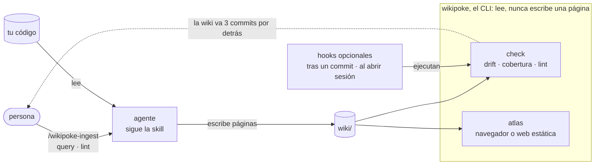
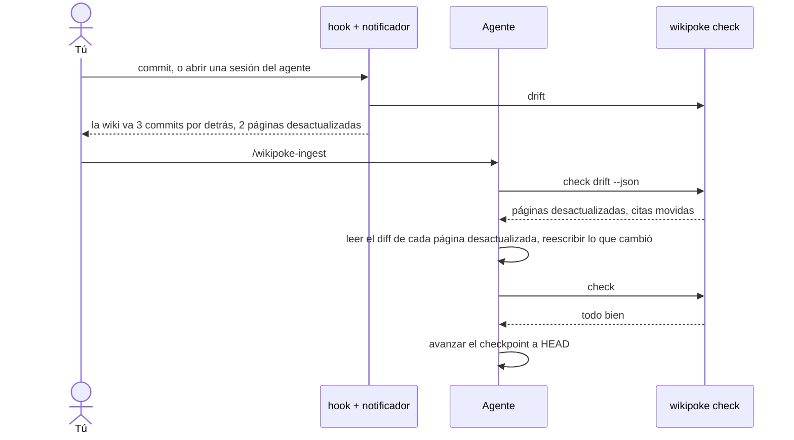
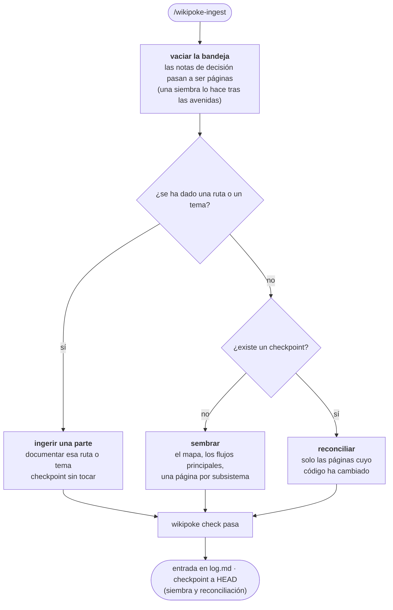
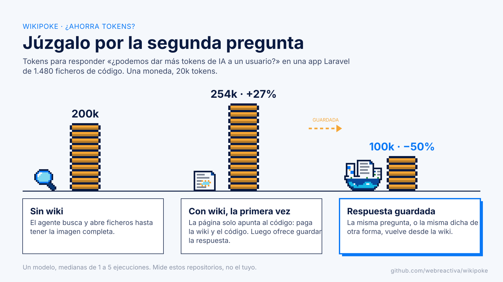
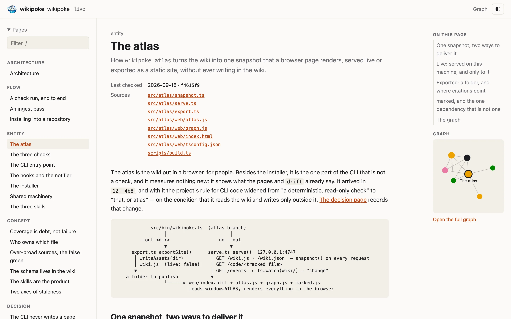
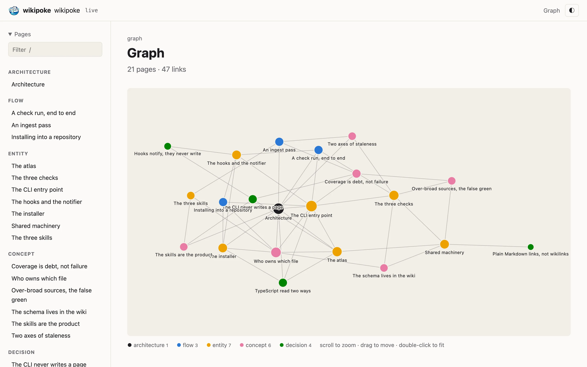

<p align="center"></p>

# Wikipoke

[English](README.md) · Español

<p align="center"><b>Una wiki del código que escribe tu agente, que se mantiene fiel al código<br>
y que crece con las preguntas que le haces.</b></p>

```sh
npm install -D wikipoke    # or: pnpm add -D wikipoke
```

Wikipoke hace que tu agente de código escriba una wiki de tu repositorio: el mapa, los flujos que
cruzan ficheros, las decisiones y por qué se tomaron, y cada afirmación apunta a una línea de código.
Cuando el código cambia, te dice qué páginas se han quedado desactualizadas y qué citas se han movido, y el
agente las vuelve a poner al día. Pregunta cómo funciona algo y el agente lee una página en vez de
explorar el repositorio. Si la página tiene la respuesta, gastas menos tokens y recibes la misma
respuesta cada vez. Si no la tiene, el agente paga la wiki y el código, y se ofrece a guardar lo que
ha encontrado para que la siguiente persona no lo pague ([medido en tres repositorios](#ahorra-tokens)).

*Una sesión en OpenCode, recortada a 47 segundos: el agente ejecuta `wikipoke init` y añade su hook,
siembra la wiki con la skill `wikipoke-ingest` (seis minutos: 20 páginas, y los ficheros de código sin
cubrir bajan de 43 a 1), y responde una pregunta sobre el código citando las líneas y las páginas que
lo cubren.*

https://github.com/user-attachments/assets/05c7f03d-da40-41a2-8e53-c66d0dce32b7

*Treinta segundos en `wikipoke atlas`, sobre la wiki que este repositorio mantiene de sí mismo: la lista de páginas, el grafo, una página con sus fuentes, el filtro.*

https://github.com/user-attachments/assets/d72063c0-20ba-4632-83ca-31e9e391ba59

Una wiki del código que mantienen los agentes. La escriben tres skills; un CLI pequeño la prepara, la
comprueba y la muestra, y nunca escribe una página.

<p align="center"></p>



- **Las skills mandan.** Una persona lanza `wikipoke-ingest`, `wikipoke-query` o `wikipoke-lint`;
  el agente sigue la skill y escribe páginas Markdown directamente en `wiki/`. Las reglas viven en
  `wiki/CONVENTIONS.md`, que es del proyecto y el proyecto edita.
- **El CLI solo mide y muestra.** `wikipoke check` es determinista: lee git y las páginas, e
  informa. `wikipoke atlas` pone esas mismas páginas en un navegador. Ninguno tiene paso de
  publicación, bloqueo, zona de preparación ni plan que seguir.
- **La cobertura es deuda, no un fallo.** El código que ninguna página cubre se lista para que la
  siguiente pasada sepa adónde ir. Un `check` normal solo falla cuando la wiki está rota: un campo
  que falta, una fuente que ya no existe, un enlace roto.

## Para qué sirve

Una memoria de tu código que sigue siendo cierta y que responde lo que ya se preguntó antes, barato
y siempre igual. Gastar menos tokens es una consecuencia de eso, en las preguntas que la wiki ya
cubre. No es una promesa para cualquier pregunta ([los números](#ahorra-tokens)).

Lo que te da que no te dan el código ni una búsqueda:

- **Lo que el código no dice.** Por qué algo está hecho así, la opción que se descartó, lo que un
  comando deja fuera, dónde se tocan dos módulos. Un `grep` encuentra un nombre, no un motivo.
- **Documentación que avisa cuando se equivoca.** Cada afirmación cita una línea, y `wikipoke check`
  lista las páginas cuyo código se ha movido y las citas que ahora apuntan a otro sitio. La
  documentación escrita a mano, y la que generó una IA una vez, se queda desactualizada en silencio.
- **Respuestas que se quedan respondidas.** La primera vez que una pregunta da con un hueco cuesta
  más que preguntar sin wiki: el agente lee la wiki y luego el código. Después se ofrece a guardar lo
  que encontró, y desde entonces esa pregunta, y la misma pregunta dicha de otra forma, se responde
  desde la wiki.
- **La misma respuesta a un coste previsible**, siempre que las páginas estén bien escritas. Una
  página vaga produce respuestas equivocadas y seguras con la misma fiabilidad. Por eso leer lo que
  se guarda es parte del trabajo, no un extra.

Cuándo compensa y cuándo no:

- **Compensa** en repositorios medianos y grandes donde personas y agentes vuelven una y otra vez a
  las mismas preguntas (triaje, onboarding, soporte) y las respuestas cruzan módulos. En una app
  Laravel de 1.480 ficheros, esas preguntas costaron un 55% y un 75% menos tokens cuando la wiki ya
  tenía sus respuestas.
- **Compensa menos** en un repositorio pequeño. Las preguntas cubiertas siguen saliendo más baratas
  (un 37% y un 49% menos en dos de ellas), pero ahí una búsqueda encuentra casi todo rápido, y
  construir la wiki tardó entre 70 y 100 preguntas en amortizarse.
- **No compensa** para preguntas sueltas, para preguntas que nombran algo que el código dice tal cual
  (lo encuentra un `grep`), ni en un equipo que no va a leer lo que guardan sus agentes.

Cómo usarlo para eso:

- **Siembra poco y crece con las preguntas.** Una siembra dibuja el mapa y los flujos principales
  (unos 5M de tokens en esa app Laravel), y cada hueco que encuentra una pregunta se guarda una vez
  (de 0,2M a 0,8M). `/wikipoke-ingest all`, que da una pasada a cada parte del código, costó 39M
  allí: sirve para documentación que quieres publicar, no para ahorrar tokens.
- **Júzgalo por la segunda pregunta, no por la primera:** lo que cuesta, y si acierta, cuando alguien
  vuelve a preguntar.

Falta por medir: si la wiki gana a un `AGENTS.md` bien cuidado más `grep`, y cuánto vale para las
personas que la leen, no solo para los agentes.

## Funcionalidades

Lo que tiene un repositorio una vez instalado wikipoke:

- 🧠 **Tres skills, para cualquier agente.** `wikipoke-ingest` siembra la wiki, la reconcilia con lo
  que ha cambiado o documenta la parte que le señales; `wikipoke-query` responde desde la wiki antes
  de abrir código; `wikipoke-lint` explica qué está mal y, con `--deep`, lee las páginas en busca de
  contradicciones y huecos. Se instalan donde mira Claude Code (`.claude/skills/`) y donde miran los
  demás agentes (`.agents/skills/`).
- ✂️ **Un `AGENTS.md` sobre el código, no sobre la wiki** (experimental). `wikipoke-agents` revisa o
  redacta el `AGENTS.md` de la raíz y los anidados que de verdad necesita un subdirectorio. Solo deja
  lo que un agente haría mal sin él, contrasta cada frase con los scripts, la CI y el historial de
  git, y enseña el cambio como diff antes de escribirlo. Suele quitar más de lo que añade, y el
  resultado nunca menciona wikipoke.
- 🕰️ **Una wiki que sabe cuándo se ha quedado desactualizada.** Cada página nombra los ficheros que documenta
  y el commit contra el que se comprobó, así que `wikipoke check drift` lista las páginas desactualizadas y
  cada cita `path:line` que el código ha movido, con la línea a la que apunta ahora. Aguanta un merge
  con squash o rebase, que tira ese commit: cada página guarda también el hash de sus fuentes, así
  que la respuesta no depende de cómo haga merge el equipo.
- 📋 **La cobertura como backlog.** El código que ninguna página cubre, agrupado por carpeta, para que
  la siguiente pasada sepa adónde ir, y cuánto esconde la lista de ignorados.
- 🩺 **Lint para la wiki.** Campos que faltan, enlaces rotos, fuentes que ya no existen, citas que
  caen en una línea en blanco, páginas a las que no enlaza nada.
- 🗺️ **El atlas.** La wiki en un navegador, redibujada en directo mientras un agente la escribe, o
  exportada como web estática; con un grafo de cómo se enlazan las páginas, como dibuja Obsidian un
  vault.
- 🔔 **Hooks opcionales.** Un aviso tras cada commit o al empezar una sesión del agente, para git,
  Claude Code, OpenCode, Cursor y `AGENTS.md`. En silencio cuando la wiki está al día, y ninguno la
  escribe nunca.
- 🧭 **Decisiones apuntadas mientras se toman** (opcional, y la única funcionalidad que cambia cómo
  trabajan los agentes en tu proyecto: [lee esto antes](#5-las-decisiones-detrás-del-código)). Con el
  hook `decisions`, o lanzando `/wikipoke-implement`, el agente que escribe el código apunta las
  decisiones que merece la pena guardar (qué eligió, qué descartó y por qué) en una bandeja de
  entrada sin commitear, y el siguiente `wikipoke-ingest` las convierte en páginas de decisión. Solo
  lo que supera un listón estricto que el proyecto fija en su `CONVENTIONS.md`: una dependencia
  nueva, un patrón de arquitectura, una decisión difícil de deshacer.
- 🗣️ **Las decisiones que tomaron personas, por escrito.** Cuéntale al agente qué decidiste y por
  qué, con tus palabras (`/wikipoke-decision <la decisión>`), y escribe la página de decisión: te
  pregunta por la alternativa que descartaste si no la has dicho, busca el código que limita y las
  páginas con las que se relaciona, avisa cuando el código dice otra cosa y te enseña el borrador
  antes de escribir nada. Una decisión que aún no se ha llevado al código se guarda como planificada
  hasta que el código la alcance ([caso de uso 6](#6-una-decisión-que-tomó-una-persona)).
- 💸 **Menos tokens en las preguntas que cubre.** Entre un 37% y un 49% menos en dos repositorios
  pequeños; en uno grande, entre un 21% y un 75% menos en cinco de seis preguntas una vez guardadas
  sus respuestas, y un 7% más en la sexta. La primera vez que una pregunta da con un hueco cuesta más
  que preguntar sin wiki ([detalles](#ahorra-tokens)).
- 🪶 **Cualquier lenguaje, sin dependencias en tiempo de ejecución.** Node 22.18 y git. El esquema es
  un fichero Markdown que es del proyecto y el proyecto edita, tipos de página incluidos; `--json` y
  `--strict` lo encajan en la CI.

## Casos de uso

Seis formas de usarlo, de principio a fin. Los comandos que empiezan por `/` van a tu agente; el
resto se ejecuta en una terminal.

### 1. El sistema completo, desde cero

Las skills escriben la wiki, los hooks notan cuándo se queda atrás y cada pasada la pone al día.

1. `npm install -D wikipoke` (o `pnpm add -D wikipoke`), y luego `npx wikipoke init` en el
   repositorio.
2. Cuando te pregunte por los hooks, elige `git` para tener un aviso tras cada commit, más el de tu
   agente: `claude`, `opencode`, `cursor` o `agents`.
3. `/wikipoke-ingest` siembra la wiki: la arquitectura, los flujos principales, una página por
   subsistema.
4. Haz commit de `wiki/`, las skills y los ficheros de los hooks, para que los tenga todo el que
   clone. Solo el hook `git` hay que instalarlo otra vez en cada clon, salvo que el repositorio use
   husky 9: entonces vive en `.husky/post-commit` y viaja con lo demás.
5. A partir de ahí, un commit o una sesión nueva del agente te dice cuándo el código ha dejado atrás
   la wiki, y `/wikipoke-ingest` reescribe solo las páginas cuyo código ha cambiado.

### 2. Preguntas que se quedan respondidas

`wikipoke-query` responde desde la wiki, y lo que tiene que sacar del código puede volver a ella.

1. Pregunta a través de la skill: `/wikipoke-query how are invoices rounded?`
2. El agente busca en la wiki los términos de la pregunta, lee en el mismo paso las páginas que
   coinciden y responde citándolas. Si la wiki no lo cubre, lee el código, responde con citas
   `path:line` y dice que la wiki tenía un hueco.
3. Se ofrece a guardar la respuesta, como sección de una página existente o como página nueva. Di
   que sí. Esa primera respuesta costó más que preguntar sin wiki: el agente leyó la wiki y luego el
   código.
4. Escribe la página, la enlaza desde sus vecinas, la añade a `index.md` y `log.md`, y ejecuta
   `wikipoke check lint`. Lee lo que ha guardado: una sección que se deja un caso es peor que no
   tenerla. La siguiente persona, o el siguiente agente, que pregunte lo encuentra ahí, y paga menos
   que preguntando sin wiki.

### 3. Las skills sin los avisos

Tras la primera pasada, quédate con la wiki y las skills, y deja de recibir avisos de que la wiki va
por detrás.

1. `wikipoke init` y `/wikipoke-ingest`, como arriba.
2. `wikipoke hooks` lista lo que está instalado; `wikipoke hooks remove git claude` quita esos dos.
   El último que quites se lleva el notificador con él.
3. `/wikipoke-query`, `/wikipoke-ingest` y `/wikipoke-lint` siguen funcionando siempre que las
   nombres.
4. Ahora nada te avisa, así que comprueba cuando importe, por ejemplo al cerrar una feature:
   `wikipoke check drift`, y luego `/wikipoke-ingest` para ponerte al día. `wikipoke hooks add
   <name>` vuelve a poner un hook.

### 4. Documentación para leer y publicar

El ingest escribe las páginas; el atlas las pone en un navegador, o en una carpeta que puedes
publicar.

1. `wikipoke init`, y luego `/wikipoke-ingest` para sembrar la wiki.
2. `wikipoke check coverage` lista el código que todavía no cubre ninguna página;
   `/wikipoke-ingest src/billing` documenta una de esas partes, y `/wikipoke-ingest all` da una
   pasada a cada parte. Es la forma cara de empezar (unos 39M de tokens en una app de 1.480
   ficheros) y merece la pena cuando lo que quieres es la web.
3. `wikipoke atlas` sirve la wiki en http://127.0.0.1:4747. Si lo dejas abierto durante una pasada,
   redibuja cada página a medida que el agente la escribe.
4. `wikipoke atlas --out site` la exporta como web estática, con las citas apuntando a tu remoto de
   GitHub o GitLab. Publica la carpeta donde alojes páginas estáticas.

### 5. Las decisiones detrás del código

El código guarda cada decisión y ninguno de sus motivos. Aquí el agente apunta el motivo mientras
todavía sabe qué descartó, y la wiki lo guarda.

> [!WARNING]
> **Esta es la única parte de wikipoke que cambia cómo trabajan los agentes en tu proyecto, no solo
> lo que leen.** Todo lo demás espera a que una persona lance una skill. Con el hook `decisions`
> activo, a cada agente que lee `AGENTS.md` y escribe código aquí se le pide que se pare en cada
> decisión que supere el listón, escriba una nota y repase su diff antes de terminar. En cada tarea,
> la pida quien la pida. En concreto:
>
> - añade un bloque a `AGENTS.md`, del que haces commit, así que lo recibe cada clon y el agente de
>   cada compañero;
> - crea `wiki/.inbox/`, una carpeta en la que escriben los agentes y que git nunca ve;
> - pone las notas delante del siguiente `/wikipoke-ingest`, que escribe páginas en `decisions/` a
>   partir de ellas, páginas que pasan a formar parte de tu wiki y de cada respuesta que sale de ella;
> - cuesta algunos tokens y algo de lectura en cada implementación, aunque no salga ninguna nota.
>
> Actívalo cuando el equipo quiera guardar decisiones, con el listón que acuerde, y díselo a quien
> trabaje en el repositorio. `wikipoke hooks remove decisions` quita el bloque. Si prefieres elegir
> caso por caso, sáltate el hook y nombra `/wikipoke-implement` cuando quieras notas.

1. `wikipoke init` y `/wikipoke-ingest`, como arriba.
2. Elige una de las dos formas de entrar; son alternativas:
   - **Siempre**: `wikipoke hooks add decisions` pide a cada agente que lee `AGENTS.md` que tome
     notas siempre que escriba código aquí.
   - **Cuando lo pidas**: `/wikipoke-implement <plan>` toma notas solo para ese trabajo. Solo se
     ejecuta cuando la nombras, nunca con un simple "implementa X".
3. Lee `## Decisions worth recording` en `wiki/CONVENTIONS.md`. Ese es el listón, y empieza
   estricto: una dependencia nueva en tiempo de ejecución, un patrón de arquitectura o una decisión
   difícil de revertir; nada de arreglos rutinarios, preferencias del linter ni nada que el código
   ya diga. Amplíalo o estréchalo ahí; en la misma sección espera, comentada, una variante más
   amplia. La mayoría de las tareas no dejan nota.
4. El agente escribe una nota por decisión en `wiki/.inbox/`, que nunca se commitea.
   `wikipoke check drift` las cuenta como `pending`, y el notificador lo dice.
5. Antes de que desaparezca la rama o el worktree, `/wikipoke-ingest` convierte las notas en páginas
   de `decisions/`, contrastadas con el código y enlazadas con el resto de la wiki, y las borra.
   Vuelve a aplicar el listón y descarta lo que no lo supera.

### 6. Una decisión que tomó una persona

Muchas decisiones las toman personas, en una reunión, una revisión o una conversación, y el código
no guarda ninguno de sus motivos. Aquí tú das el motivo y el agente escribe la página.

1. `wikipoke init` y `/wikipoke-ingest`, como arriba: la página necesita una wiki a la que enlazarse.
2. Cuéntale al agente la decisión, qué elegiste, qué descartaste y por qué:
   `/wikipoke-decision we keep the CLI read-only: a writing CLI would need a lock and a staging
   area, and the skills already write`. También vale un simple "record this decision: …".
3. Si falta algo, normalmente la alternativa que descartaste, lo pregunta, de una en una. Si no hay
   ninguna alternativa, dice que no hay decisión que guardar, y en su lugar te manda a poner la
   regla en `AGENTS.md`.
4. Lee la wiki y el código. Si ya hay una página de decisión sobre el mismo tema, la amplía, o, si
   la nueva decisión le da la vuelta, la sustituye. Cuando el código no hace lo que decidiste, lo
   dice con el fichero y la línea, y eliges tú: guardarla como planificada, para código que está por
   llegar, o corregir lo que le contaste. Cuando la decisión deja abierto algo de lo que depende el
   código, también te hace esa pregunta. Una política sin código detrás cita el fichero que la
   establece, como `AGENTS.md` o un workflow de CI.
5. Te enseña la página y todos los demás cambios, y solo escribe cuando le dices que sí. Luego
   ejecuta `wikipoke check lint`.

Qué cambia en tu proyecto:

- `init` escribe una skill más, `wikipoke-decision`, en las dos carpetas de skills. Un agente puede
  cargarla por su cuenta cuando le pides que guarde una decisión, pero no escribe nada hasta que
  apruebas el borrador.
- Cada sí escribe una página en `wiki/decisions/`, un enlace a ella desde las páginas con las que se
  relaciona, una línea en `wiki/index.md` y una entrada en `wiki/log.md`, todo ficheros de los que
  haces commit. Nunca toca tu código, `.wikipoke-state.json` ni la bandeja de entrada, y no hace
  commit de nada por su cuenta.
- Las páginas de decisión pueden llevar tres claves además de las de la plantilla: `decided_by:
  person` (o `agent`, para una que salió de una nota); `planned: true` mientras el código no lleve a
  cabo la decisión, que el siguiente `/wikipoke-ingest` quita cuando llega ese código; y `status:
  deprecated` en una decisión que otra ha revertido, que conserva la página antigua como historia.
  Una reversión que aún está planificada deja en vigor la página antigua; el ingest que quita
  `planned:` la marca. `status` es una clave propia del
  [Open Knowledge Format](https://github.com/GoogleCloudPlatform/open-knowledge-format), así que la
  wiki sigue siendo un bundle válido. `wikipoke check` ignora las tres.

## Instalación

Node 22.18 o posterior y git. Wikipoke no tiene dependencias en tiempo de ejecución: el CLI es
TypeScript que se compila a ESM plano al instalarlo, y todo lo que necesita al ejecutarse está en la
librería estándar de Node. Dos librerías viajan dentro del paquete en vez de instalarse con él:
[marked](https://marked.js.org), que renderiza el Markdown en la página del atlas, y
[@clack/prompts](https://github.com/bombshell-dev/clack), que dibuja las preguntas de `init`. Las dos
son devDependencies que el build copia o empaqueta junto al código compilado, con sus licencias.

```sh
npm install -D wikipoke        # in a JavaScript project; run it as `npx wikipoke`
pnpm add -D wikipoke           # the same with pnpm; run it as `pnpm wikipoke`
npm install -g wikipoke        # any other repository, any language: `wikipoke` everywhere
```

Los comandos de este README están escritos como `wikipoke …`; con una instalación local, ponles
delante `npx` o `pnpm`.

Para usar el código más reciente sin publicar, `github:webreactiva/wikipoke` funciona en cualquiera
de los dos comandos, y `npm run link` dentro de este repositorio lo compila y pone `wikipoke` en tu
`PATH` (`npm run unlink` lo vuelve a quitar).

> [!WARNING]
> No apuntes un proyecto a un checkout con `npm install -D ../wikipoke`: npm enlaza la carpeta y
> ejecuta su `prepare` allí, que falla salvo que el checkout ya tenga sus propias devDependencies, y
> el `package.json` del proyecto acaba nombrando una ruta que solo existe en tu máquina. Enlázalo de
> forma global; los hooks encuentran un `wikipoke` global igual que uno local.

Después, en el repositorio:

```sh
wikipoke init
```

En una terminal, `init` pregunta una cosa cada vez: dónde debe vivir la wiki (`wiki/` salvo que
digas otra cosa), un sí a la lista de ficheros que va a escribir (no escribe nada antes, y si
cancelas ahí sale con 1) y qué hooks quieres. Encima de la lista de hooks dice qué toca cada uno, si
se commitea y cuáles están instalados o desactualizados. Los hooks que sugieren los ficheros de tu
agente empiezan marcados; desmarcar uno que ya está instalado lo deja como está. Elegir otra carpeta
para una wiki que ya existe empieza una nueva y vacía allí, e `init` lo dice antes de preguntar:
mover las páginas te toca a ti. `--dir` responde la primera pregunta por adelantado; `--yes` no
pregunta nada, como una ejecución sin terminal. Termina diciéndote cómo empezar: en tu agente,
ejecuta la skill `wikipoke-ingest` (`/wikipoke-ingest` en Claude Code) para sembrar la wiki. Dibuja
las avenidas (la arquitectura, los flujos principales, una página por subsistema) y se para; las
pasadas siguientes la hacen crecer parte a parte.

**Instalar a través de un agente.** Un agente puede ejecutar `wikipoke init` por ti. Sin nadie en la
terminal, o con `--yes` para un agente cuyos comandos corren en una terminal real, no hay preguntas:
`init` escribe los ficheros de golpe, no instala ningún hook y le pasa la decisión al agente en vez
de olvidarla: imprime lo que falta, lo que haría cada hook y el comando. Cuál encaja es algo que el
agente sabe de sí mismo e `init` no puede ver, así que te pregunta a ti y ejecuta `wikipoke hooks
add <name>`. Nada instala un hook por su cuenta.

## Qué escribe `init`

| Fichero | De quién es | Para qué |
| --- | --- | --- |
| `wiki/CONVENTIONS.md`¹ | del proyecto | el esquema: tipos de página, la plantilla, las reglas de escritura |
| `wiki/.wikipokeignore`¹ | del proyecto | ficheros que nunca cuentan para la cobertura (tests, lockfiles, …); una línea con `!` recupera algunos |
| `.agents/skills/wikipoke-*/SKILL.md` | de wikipoke | las skills, para los agentes que leen la carpeta neutral |
| `.claude/skills/wikipoke-*/SKILL.md` | de wikipoke | las mismas skills, para Claude Code, que solo lee esta |

¹ O el directorio que fije `--dir`, ver más abajo.

Para añadir un tipo de página propio (un `runbook`, un `incident`), añade una fila a la tabla "Page
types" de `wiki/CONVENTIONS.md` y una entrada en "Where each type comes from": qué contiene una
página de ese tipo y dónde están sus pruebas. La fila hace que `wikipoke check` acepte el tipo; la
entrada es lo que leen las skills para escribir, guardar y buscar esas páginas.

Siempre se escriben las dos carpetas de skills. Claude Code solo lee `.claude/skills` y funciona
perfectamente en un checkout sin `.claude/` y sin `CLAUDE.md`, así que no hay nada en un repositorio
por lo que detectarlo. Escribir las skills para un agente que nunca llega cuesta unos cuantos
ficheros Markdown inertes; no escribirlas le cuesta al agente todas sus skills. Una skill es inerte
en cualquier caso, porque nada la ejecuta hasta que una persona la nombra, y esa es justo la razón
por la que los hooks se tratan de otra manera más abajo.

`init` nunca escribe páginas, `index.md`, `log.md` ni `.wikipoke-state.json`: eso lo hace la primera
pasada del ingest.

**En otro sitio que no sea `wiki/`.** `wikipoke init --dir docs/wiki` pone la wiki ahí y escribe un
`.wikipoke.json` de una línea para que todos los comandos posteriores estén de acuerdo. Las skills,
los hooks y el esquema se escriben con la ruta real dentro, así que nada tiene que buscarla. Para
mover una wiki existente, mueve la carpeta, edita `.wikipoke.json` y vuelve a ejecutar `init` para
refrescar las skills.

## Hooks (opcionales)

Un hook te avisa a ti o a tu agente, en el momento justo, de que la wiki se ha quedado atrás. Todos
los hooks menos `decisions` ejecutan el mismo notificador, `wiki/.wikipoke-hook.sh`, que imprime lo
que encuentra `drift`, se queda en silencio cuando la wiki está al día y nunca falla ni llama a un
modelo. Ninguno escribe la wiki. La cobertura se queda fuera a propósito: ese backlog está pensado
para sobrevivir a todas las pasadas, y un notificador que lo repite en cada commit y en cada inicio
de sesión nunca está en silencio, que es como acaba silenciado un notificador.



> [!IMPORTANT]
> **Instala al menos uno.** Sin un hook nada te dice nunca que la wiki se ha quedado desactualizada
> (`wikipoke check` solo habla cuando alguien lo ejecuta), y una wiki de la que nadie se entera es
> una wiki que deja de ser cierta sin hacer ruido. `wikipoke hooks` lo dice siempre que no hay
> ninguno instalado.

Solo `git` hay que instalarlo otra vez en cada clon, porque `.git/hooks` no está versionado; los
demás son ficheros normales del repositorio, así que con hacer commit de uno ya lo tiene todo el que
clone.

```sh
wikipoke hooks                        # the list: which are installed, which are outdated
wikipoke hooks add git claude         # install some, or update installed ones
wikipoke hooks remove claude          # take one out
```

| Hook | Escribe | Habla |
| --- | --- | --- |
| `git` | `.git/hooks/post-commit` | tras cada commit, en tu terminal (por clon) |
| `claude` | una entrada `SessionStart` en `.claude/settings.json`, más las skills de Claude Code | cuando empieza una sesión de Claude Code |
| `opencode` | `.opencode/plugin/wikipoke.js` | cuando empieza una sesión de OpenCode, una vez por sesión |
| `cursor` | `.cursor/rules/wikipoke.mdc` | una regla que Cursor lee en cada sesión |
| `agents` | un bloque delimitado en `AGENTS.md`, que se crea si no existe | Codex y cualquier agente que lea `AGENTS.md` |
| `decisions` | su propio bloque en `AGENTS.md`, y `wiki/.inbox/.gitignore` | nunca: pide a los agentes que apunten decisiones mientras trabajan ([caso de uso 5](#5-las-decisiones-detrás-del-código)) |

El notificador se escribe con el primer hook que lo ejecuta y se borra con el último. `decisions` no
lo ejecuta, así que por sí solo no avisa a nadie de que la wiki va por detrás: combínalo con uno que
sí lo haga. `hooks remove decisions` conserva el fichero de ignorados de la bandeja mientras siga
habiendo notas dentro.

## Ficheros que gestiona wikipoke

Los ficheros del proyecto (`CONVENTIONS.md`, `.wikipokeignore`) se escriben una vez y nunca se
sobrescriben; cuando `CONVENTIONS.md` difiere de la plantilla que trae un wikipoke más nuevo, `init`
lo dice y nombra la plantilla, para que el proyecto se lleve lo que quiera. Los ficheros de wikipoke
llevan una línea `managed by wikipoke`. Si en su lugar hay un fichero sin esa línea, se deja como
está, y el comando dice qué añadir a mano. En los ficheros compartidos (`.claude/settings.json`,
`AGENTS.md`) wikipoke solo añade y quita su propia entrada.

**Después de actualizar wikipoke**, ejecuta `wikipoke update`, en el mismo paso que la
actualización:

```sh
npm install -D wikipoke@latest && npx wikipoke update
```

Refresca las skills y actualiza los hooks que instaló una versión anterior, e imprime cada fichero
que ha cambiado. No instala ningún hook que no estuviera, y conserva `CONVENTIONS.md` y
`.wikipokeignore`, que son del proyecto: te avisa cuando el `CONVENTIONS.md` que trae ha cambiado,
para que te lleves lo que quieras. `wikipoke init` también refresca las skills, pero solo lista los
hooks desactualizados.

## Las skills

| Skill | Qué hace |
| --- | --- |
| `wikipoke-ingest` | siembra la wiki; reconcilia las páginas con lo que ha cambiado desde el checkpoint; o, si le das una ruta o un tema, documenta una parte que ninguna pasada ha cubierto (`all`: cada parte, una pasada cada una) |
| `wikipoke-query` | responde primero desde la wiki, recurre al código si hace falta y se ofrece a guardar la respuesta |
| `wikipoke-lint` | explica lo que ha encontrado `check`; con `--deep`, lee las páginas en busca de contradicciones, afirmaciones caducadas, huecos, y los flujos y decisiones que la cobertura no puede pedir |
| `wikipoke-decision` | escribe una decisión que tomó una persona, con sus palabras, como página de decisión: pregunta lo que falta, la contrasta con el código, enseña el borrador y escribe tras un sí |
| `wikipoke-implement` | implementa un plan y va apuntando en `wiki/.inbox/` las decisiones que merece la pena guardar; solo se ejecuta cuando la nombras |
| `wikipoke-agents` *(experimental)* | revisa o escribe `AGENTS.md`, y los anidados que necesita un subdirectorio, sobre el código y no sobre la wiki; enseña el cambio como diff y solo escribe tras un sí |

`wikipoke-agents` es la única skill que no toca la wiki, y no la necesita: trabaja a partir de los
scripts, la CI, la configuración de las herramientas y los commits `fix` del historial de git. Juzga
el fichero frase a frase y solo conserva una frase si un agente haría algo mal sin ella, el
repositorio puede respaldarla y un `ls` o un `grep` no la encontraría. El contenido siempre va en
`AGENTS.md`, y `CLAUDE.md` se queda en un único import `@AGENTS.md`, para que todos los agentes lean
el mismo fichero. Es experimental: solo se ha probado en este repositorio, y todavía no está medido
si los agentes se equivocan menos con el fichero que escribe.

> [!TIP]
> Haz las preguntas con `/wikipoke-query <pregunta>`. Un agente no siempre va a la wiki por su
> cuenta, y el ahorro de más abajo solo aparece cuando lo hace.

`wikipoke-ingest` decide qué tipo de pasada hacer según los argumentos y el estado de la wiki, así
que el mismo comando siembra un repositorio nuevo y mantiene al día uno viejo:



## ¿Ahorra tokens?

<p align="center"></p>

A veces. Ahorra tokens en las preguntas que ya responde una página, y cuesta más en las que no.
Tres repositorios, un modelo (glm-5.3-flash a través de OpenCode), una sesión nueva por pregunta.
Los tokens son todo lo que procesó el modelo (entrada, entrada cacheada y salida) durante toda la
respuesta.

**Dos repositorios pequeños de TypeScript**, el mismo código en dos ramas, una con una wiki
sembrada; tres preguntas que cubre una página de la wiki, tres ejecuciones cada una:

| Repositorio | Sin wiki (mediana de tokens por pregunta) | Con `/wikipoke-query` | Tokens | Coste |
| --- | --- | --- | --- | --- |
| una librería: 32 ficheros de código, ~11k líneas, un tercio de ellas comentarios | 308k | 157k | −49% | −40% |
| un CLI: 39 ficheros de código, ~7,5k líneas, 7% de comentarios | 384k | 242k | −37% | −48% |

**Una aplicación Laravel con 1.480 ficheros de código**, preguntas de triaje como las que hace un
equipo sobre un bug o una feature, cada una hecha sin la wiki (con la carpeta movida fuera), con una
wiki cuya página solo apuntaba al código, y otra vez cuando la respuesta ya se había guardado.
Medianas de 1 a 5 ejecuciones:

| Pregunta | Sin wiki | Wiki, la página apunta al código | Wiki, respuesta guardada |
| --- | --- | --- | --- |
| un miembro del equipo no ve el contenido premium | 425k | 133k | 105k (−75%) |
| a un suscriptor nunca le llegó el email de bienvenida | 232k | 200k | 105k (−55%) |
| ¿podemos dar a un usuario más tokens de IA? | 200k | 254k | 100k (−50%) |
| ¿tenemos exportación de datos para el RGPD? | 102k | 186k | 75k (−26%) |
| el enlace de bienvenida dejó de funcionar | 126k | 263k | 100k (−21%) |
| un feed de podcast privado dejó de actualizarse | 101k | 203k | 108k (+7%) |

El ahorro sale de los pasos, no de lecturas más cortas. Cada paso vuelve a enviar toda la
conversación (unos 20k a 30k tokens de system prompt y definiciones de herramientas antes de leer
nada), así que una respuesta cuesta más o menos su número de pasos. Sin la wiki, el agente busca y
abre ficheros hasta que tiene la foto completa. Con ella, lee las páginas y abre código solo para lo
que les falta: cuando una página tiene la respuesta son tres o cuatro pasos, y cuando solo apunta al
código el agente paga la wiki y luego el código, hasta el doble de lo que costaba la pregunta sin
ella. Esa primera respuesta es el momento en que `wikipoke-query` se ofrece a guardar lo que
encontró, y una vez guardada, la misma pregunta, y la misma pregunta dicha de otra forma, volvió
solo desde la wiki.

Dónde ayuda menos la wiki: una pregunta que nombra algo que el código dice tal cual ("GDPR" está en
la descripción del comando de exportación) la resuelve un `grep`, así que una wiki apenas puede
ganarle, y solo lo hizo cuando la skill buscó y leyó las páginas en una sola llamada. Donde más
ayuda es en la pregunta que cruza módulos sin una palabra que buscar, en la que el agente sin wiki a
veces lanzaba subagentes y gastaba entre 400k y 500k.

Las mismas ejecuciones enseñaron más que tokens:

- **Nombra la skill cuando quieras el ahorro.** Dejándole decidir, el agente abrió la wiki en 17 de
  18 ejecuciones con la descripción actual de la skill y ahorró más o menos lo mismo (−50% y −38% de
  mediana), pero solo en 3 de 9 en la librería con una descripción anterior que saltaba con "how
  does X work", y cada vez que se salta la wiki se paga en exploración. `/wikipoke-query` quita la
  duda.
- **Una página es tan buena como sus frases.** Una página explicaba dos casos en el mismo párrafo.
  Cuatro de seis respuestas que la leyeron los mezclaron, mientras que todas las que leyeron el
  código los mantuvieron separados; reescrita con una frase por caso, acertaron seis de seis. En la
  app Laravel, una página que no decía en qué sentido funciona el signo de un ajuste llevó a dos de
  cada tres respuestas a afirmarlo al revés, con seguridad; una vez guardado, acertaron tres de tres.
  `CONVENTIONS.md` recoge la regla.
- **Lee lo que se guarda.** Dos de las cuatro primeras respuestas guardadas se dejaron fuera parte de
  lo que se había preguntado, y una mantuvo una frase falsa de antes. Ahora la skill vuelve a leer
  la sección guardada contra la pregunta, y las dos siguientes salieron completas.
- **La wiki cuesta tokens construirla, y solo se amortiza con preguntas.** Cubrir todo el backlog de
  la librería costó unos 14M de tokens, amortizados tras unas 70 a 100 preguntas. En la app Laravel
  una siembra costó unos 5M, cubrirlo todo 39M (y reclamó carpetas que nadie había leído hasta que la
  skill lo prohibió), y guardar un hueco de 0,2M a 0,8M. Una siembra más los huecos que encuentran
  tus preguntas es la forma barata de empezar; `all` tiene sentido para documentación que quieres
  publicar, no para ahorrar tokens.

> [!NOTE]
> Un modelo, de 1 a 5 ejecuciones por celda y mucha dispersión (una respuesta sin wiki en el CLI se
> llevó 1,6M de tokens), y 4 de 24 ejecuciones en Laravel en las que el modelo no devolvió ninguna
> respuesta. Esto mide estos repositorios, no el tuyo.

## `wikipoke check`

```sh
wikipoke check              # all three
wikipoke check drift        # commits not indexed, stale pages, citations the code moved, pending decision notes
wikipoke check coverage     # tracked files no page's `sources:` claims
wikipoke check lint         # fields, types, links, citations, dead and over-broad sources, orphans
wikipoke key [<page>...]    # what each page's sources hash to now, for its `sources_key:`
```

`--json` para las skills, `--strict` para salir con 1 ante cualquier hallazgo salvo el aviso de
squash de más abajo (CI), `-v` para listar cada fichero.
`--against <ref>` mide el drift en ese commit en vez de en tu árbol de trabajo, así que la respuesta
es la misma desde cualquier rama: `wikipoke check --against origin/main --strict` en la CI de main.
Drift lee del ref tanto el código como la wiki (páginas, checkpoint, `.wikipokeignore`); lint y
coverage, que `check --against` también ejecuta, siguen leyendo el checkout.
Esa receta aguanta tras un merge con squash o rebase de una rama que hizo una pasada. El checkpoint
nombra entonces un commit que main no tiene, así que drift cuenta desde el merge, el último commit
que escribió ese checkpoint, y lo dice una vez que main lo deja atrás. Para eso la CI necesita el
historial completo (`fetch-depth: 0`): un clon superficial da el checkpoint por roto. Las páginas
que la pasada volvió a sellar avisan de que su `synced:` ha desaparecido, y `--strict` no falla con
ese aviso: es deuda que salda la siguiente pasada de reconciliación al volver a leer esas páginas
contra el código.
Una ejecución normal solo sale con 1 ante errores de lint. Las notas de decisión pendientes nunca la
hacen fallar, y la CI nunca las ve: la bandeja no se commitea.

`check` y `check lint` también dicen cuánto hace de la última revisión profunda de las páginas,
leído de `log.md`:

```text
lint      last deep pass: 41 days ago -> wikipoke-lint --deep
lint      last deep pass: never -> wikipoke-lint --deep
```

Esta línea es información: no hace fallar nada, ni siquiera con `--strict`. `--json` da el día como
`lint.lastDeepLint` (`null` si nunca). Se pone amarilla cuando la pasada tiene más de 30 días; si no
ha habido ninguna, los 30 días cuentan desde el primer día del log, así que a una wiki recién
sembrada no le toca todavía. `check drift` nunca la imprime, así que el notificador sigue callado
con una wiki al día.

## `wikipoke atlas`

```sh
wikipoke atlas              # the wiki at http://127.0.0.1:4747, redrawn as pages change
wikipoke atlas --port 8080
wikipoke atlas --out site   # the same page as a static site: open index.html, or publish the folder
```

Un lector para personas. Las páginas se agrupan por los valores de `type:` de `CONVENTIONS.md`, y
cada una empieza con su `responsibility`, la fecha y el commit contra el que se comprobó por última
vez (`synced:`) y sus fuentes. Termina con las páginas con las que se relaciona y las que enlazan a
ella, y con una nota sencilla por cada advertencia que lleve: que parte de ella es una
reconstrucción (`confidence: inferred`), o que hay ficheros que cambiaron después de comprobarla (lo
que drift llama desactualizada), con sus nombres. Los encabezados forman un índice junto a la página, y `/`
filtra la lista de páginas.



El grafo dibuja las páginas como nodos y sus enlaces como aristas, como hace Obsidian: una vista
propia, donde haces zoom, te desplazas y arrastras, y una pequeña junto a cada página con las
vecinas de esa página. Los nodos se colorean por tipo, su tamaño depende de cuántos enlaces tienen y
llevan un anillo cuando están desactualizados; al pasar por encima de uno se ilumina lo que toca, y
al hacer clic se abre la página.



En directo, una cita abre el fichero citado en su línea, servido solo si git lo sigue, y la página se
redibuja cuando cambia un fichero de `wiki/`, así que puedes ver una pasada de ingest mientras va
llegando. Se para en la wiki: un cambio en el código aparece como página desactualizada en el siguiente
redibujado, no por sí solo.
Exportado, las citas apuntan al remoto (GitHub o GitLab) en el commit `synced:` de cada página, que
es el código contra el que se comprobó la página por última vez, y la foto se toma en el momento en
que exportas. `--out` solo escribe en un directorio nuevo o vacío, o en uno que hizo una exportación
anterior, y nunca dentro de la wiki.

## Una página

```markdown
---
title: Billing
type: entity
responsibility: How invoices are computed, rounded and taxed.
sources:
  - src/billing/
synced: a1b2c3d
---

Invoices round per line, not per total, because… See [the checkout flow](../flows/checkout.md).
```

`sources:` ata la página al código y `synced:` al commit contra el que se comprobó; juntos son como
`drift` sabe que la página está desactualizada. Los enlaces son Markdown normal, así que `check` puede
verificar cada uno, y lo mismo las citas del cuerpo: `path:line`, o un enlace con un ancla de línea
de GitHub (`#L42`). `drift` lleva cada cita a través del diff desde el commit que la escribió y dice
a qué línea apunta ahora (en una página desactualizada, y en una que se volvió a sellar sin mover sus
punteros), y `lint` vuelve a leer cada una e informa de las que caen más allá del final de su
fichero, en una línea en blanco o en un corchete de cierre suelto. El contrato completo está en el
`CONVENTIONS.md` que escribe `init`, y los valores válidos de `type:` son las filas de su tabla de
tipos de página.

**Se lee sin wikipoke.** Una wiki es también un bundle
[Open Knowledge Format](https://github.com/GoogleCloudPlatform/open-knowledge-format) v0.2: cada
fichero que no sea `index.md` ni `log.md` tiene un frontmatter que lee un parser YAML estricto, con
un `type`; `index.md` declara `okf_version: "0.2"`; y `log.md` lista las pasadas de la más nueva a
la más antigua, con un encabezado `## YYYY-MM-DD` por día. `lint` avisa cuando una página,
`CONVENTIONS.md` o el log se apartan de eso; a una wiki hecha con un wikipoke anterior le reescribe
el log la siguiente pasada que lo escriba. Cada documento de la wiki de este repositorio carga sin
errores en el parser del agente de referencia de OKF. Las páginas llevan más de lo que pide OKF
(`sources:`, `synced:`, `responsibility:`); OKF permite claves extra. Las skills también escriben
las claves de confianza propias de OKF: `generated:` cuando una pasada escribe o reescribe las
afirmaciones de una página, `verified:` cuando una pasada vuelve a leer el código y la página sigue
siendo cierta, cada una con quién lo hizo (`claude-code/<model>`, `human:<id>`) y cuándo. Así, una
página que solo se volvió a comprobar se lee distinta de una que se reescribió; `lint` comprueba su
forma.

## Desinstalar

```sh
wikipoke uninstall
```

Quita las skills y todos los hooks, incluidas las entradas de wikipoke en ficheros compartidos.
`wiki/` se queda: es el conocimiento del proyecto.

## De dónde viene

El diseño es la wiki del repositorio widgetron, hecha independiente del repositorio: los mismos tres
verbos (siguiendo el patrón de wiki mantenida por LLM de Andrej Karpathy), las mismas
comprobaciones y el mismo contrato de página. La versión 0.1, en el historial de `main`, tomó otro
camino, con el CLI como escritor (lotes planificados, publicación por fases, un bloqueo de escritura,
un sello de completitud). Los agentes acabaron manejando el CLI en vez de seguir las skills, y cada
ejecución real sacaba reglas nuevas que añadir. Esta versión deja la escritura en las skills y el
CLI en solo lectura.

## Desarrollo

El CLI es TypeScript en `src/`, y se lee de dos maneras distintas.

```sh
npm test         # node --test test/*.test.ts — runs the sources, no build first
npm run typecheck
npm run build    # tsc -> dist/, the ESM that actually ships, plus atlas's page, marked and clack
npm run link     # build, then `npm link`: the working copy becomes your global wikipoke
npm run unlink   # take it off the PATH again
```

**Publicar una versión.** Un tag de versión es toda la release. `npm version` sube la versión de
`package.json`, hace commit y pone el tag al commit; al hacer push del tag se ejecuta
`.github/workflows/release.yml`, que pasa las mismas comprobaciones que una pull request, publica ese
commit en npm con provenance y crea la release de GitHub con notas generadas a partir de las pull
requests mergeadas. Antes de poner el tag, haz la comprobación de principio a fin con un agente que
se describe en [`validation/`](validation/README.md) y haz commit de su entrada en el log:

```sh
npm version patch        # or minor: bumps, commits "0.3.2", tags v0.3.2
git push --follow-tags
```

Un tag que no coincide con `package.json` no publica nada. No hay token de npm: npm confía en el
propio workflow (trusted publishing), configurado una vez en npmjs.com para este repositorio y
`release.yml`.

Node ejecuta un fichero `.ts` quitándole los tipos, así que durante el desarrollo no hay nada que
compilar y los tests ejercitan el mismo fichero que acabas de editar. Pero se niega a hacerlo con
cualquier cosa dentro de `node_modules/`, que es justo donde vive un wikipoke instalado, así que lo
que se publica está compilado: `prepare` ejecuta `tsc` al instalar, y `bin` apunta a
`dist/bin/wikipoke.js`.

Dos consecuencias para quien edite `src/`: los imports nombran el fichero `.ts` (`./lib.ts`; `tsc`
reescribe el especificador a `.js` cuando emite), y solo se permite sintaxis que se borra sin dejar
nada: nada de `enum`, ni `namespace`, ni parameter properties. `erasableSyntaxOnly` en
`tsconfig.json` hace fallar la comprobación en vez de dejar pasar una.

La página del atlas, en `src/atlas/web/`, es la excepción: HTML, CSS y JavaScript planos que el
navegador ejecuta tal cual, y que `scripts/build.ts` copia a `dist/` junto con marked. `atlas.js`
sigue pasando el type-check, con su propio `tsconfig.json`, contra los tipos del snapshot.

Las preguntas de `init` llegan a `@clack/prompts` a través de un único módulo, `src/lib/prompts.ts`,
y ningún otro puede importarlo. El build empaqueta ese módulo con esbuild en `dist/lib/prompts.js`,
escribe al lado las licencias de lo que ha entrado y falla si algún otro fichero de `dist/` sigue
importando `@clack/`: ese import se resolvería en tu máquina y rompería todas las instalaciones.
